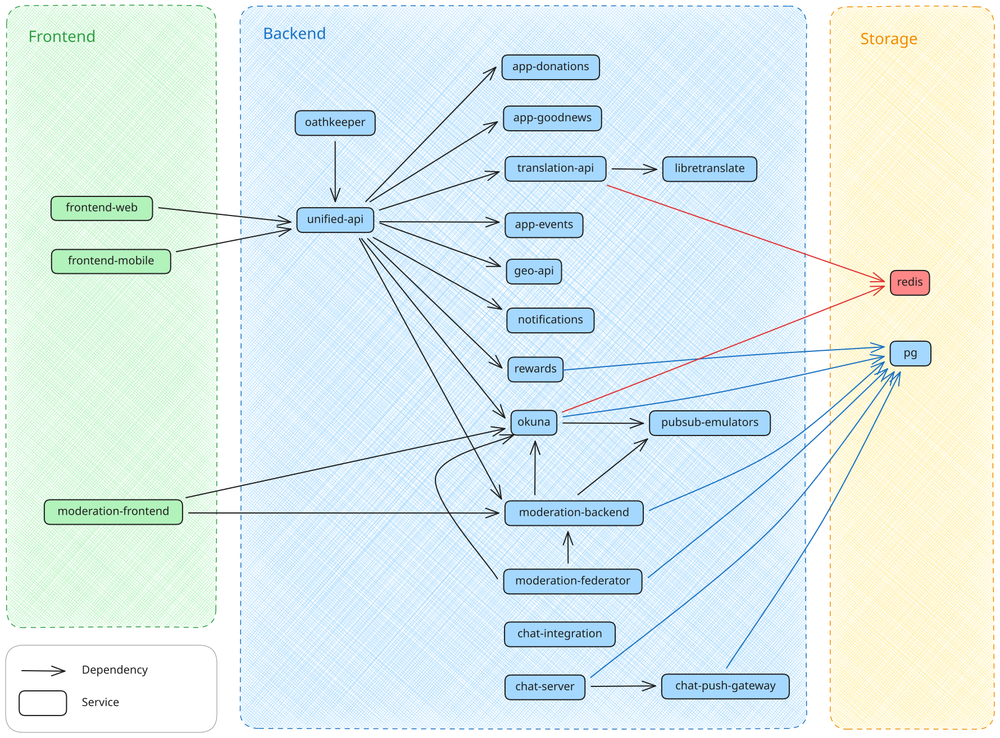

# holi-meta

The meta repository which helps you check out the other repositories and run a development environment locally.

- [holi-meta](#holi-meta)
  - [Preface](#preface)
  - [Getting started](#getting-started)
    - [Requirements](#requirements)
      - [Docker Compose](#docker-compose)
        - [Start Docker Desktop (optional)](#start-docker-desktop-optional)
      - [gcloud](#gcloud)
      - [direnv](#direnv)
        - [Installation](#installation)
        - [Configuration](#configuration)
    - [Initialization](#initialization)
    - [IDE setup](#ide-setup)
    - [Last steps](#last-steps)
  - [Running dev environments via docker compose](#running-dev-environments-via-docker-compose)
    - [Get Started](#get-started)
      - [Setting Up Chat Server Admin User](#setting-up-chat-server-admin-user)
    - [Commands](#commands)
      - [Start](#start)
      - [Mobile](#mobile)
      - [Mprocs](#mprocs)
      - [Status](#status)
      - [Logs](#logs)
      - [Stop](#stop)
      - [Migrate](#migrate)
        - [Recreate the database](#recreate-the-database)
        - [Migrate the database](#migrate-the-database)
        - [Access the PostgreSQL instance](#access-the-postgresql-instance)
      - [Services](#services)
      - [Attach](#attach)
      - [Build](#build)
      - [Compose](#compose)
    - [Troubleshooting](#troubleshooting)
      - [Service fails to start or unhealthy status](#service-fails-to-start-or-unhealthy-status)
      - [Frontend Image Build Error: Cannot Allocate Memory](#frontend-image-build-error-cannot-allocate-memory)
      - [Deno lockfile version mismatch](#deno-lockfile-version-mismatch)
  - [Contribution Guide](#contribution-guide)
    - [Core Concepts](#core-concepts)
    - [holi-meta Structure](#holi-meta-structure)
    - [Services](#services-1)
      - [Service Dependencies](#service-dependencies)
      - [Add a service](#add-a-service)
    - [Docker Compose features used](#docker-compose-features-used)
    - [`holi-dev.sh` script](#holi-devsh-script)
      - [Rebuild Check Script](#rebuild-check-script)
    - [Internal Troubleshooting](#internal-troubleshooting)

## Preface

holi is quite complex, consisting of many components, running on a diverse tech stack. Because of this, setting up a development environment is hard to do without help. Even with help, it can go wrong.

We tried and are trying continuously to give our best support for setting up a dev environment. This manual is very detailed, while leaving some degrees of freedom to the developer. In order to succeed in setting up your dev environment, please try to follow this documentation as strict as you can. If you are running into issues during the setup that you can't figure out and where the documentation is lacking, feel free to contact the holi dev team for support.

## Getting started

### Requirements

#### Docker Compose

This project uses Docker Compose to run its development environment.
Please [`install Docker Compose`](https://docs.docker.com/compose/install/) via the plugin, not as standalone. Afterwards, you might need to log out of your console and back in again.

##### Start Docker Desktop (optional)

If you installed Docker Compose via Docker Desktop, you need to start it before development, or else the development environment will not successfully start.

#### gcloud

Please install [`gcloud` CLI](https://cloud.google.com/sdk/docs/install) and authenticate with your Google account using

```sh
gcloud auth login
```

#### direnv

##### Installation

Please install [`direnv`](https://github.com/direnv/direnv/blob/master/docs/installation.md) (can be installed via `brew install direnv`

##### Configuration

Please set up the [shell hook](https://github.com/direnv/direnv/blob/master/docs/hook.md)) for direnv.

### Initialization

Once you have installed all prerequisites (or after anything changed in the setup), you can execute

```sh
./init.sh
```

and the script will set up everything for you. At the end, it will display a big `DONE` banner. If it does not,
then either it ran into an error, giving a message, or stopped due to a bug. Try to fix the error and then re-run the script.

If you also want to work on any optional, private repositories, then please execute

```sh
./init.sh full
```

for doing a full checkout.

### IDE setup

Now you can open the projects in your favourite IDE. It's up to you whether you open the holi-meta folder or the checked
out project subfolders in several IDEs .

### Last steps

1. Run the following command to authorize Docker to access the Google Cloud Artifact registry.

  ```
  gcloud auth configure-docker europe-north1-docker.pkg.dev
  ```

2. Run `./holi-dev.sh init` to create the necessary environment files.
3. Fill the following secrets from passbolt:

- The Unified API uses imagekit.io for media processing. Please set the `IMAGEKIT_PUBLIC_KEY` and `IMAGEKIT_PRIVATE_KEY` available in Passbolt in `./holi-okuna/.docker-compose.env.local`.
- Set `HOLI_CHAT_ORY_CLIENT_ID` and `HOLI_CHAT_ORY_CLIENT_SECRET` in `./holi-chat-server/.envrc.local`.
- Fill `HOLI_CHAT_REGISTRATION_SHARED_SECRET` in `./holi-chat-server/.envrc.local` with `HOLI_CHAT_REGISTRATION_SHARED Development` from Passbolt.
- Set `APNS_KEY_ID`, `APNS_TEAM_ID`, and `APNS_TOPIC` in `./holi-chat-server/.envrc-push-gateway.local`.
- Fill `./holi-chat-server/data-push-gateway/apns_keyfile_staging.p8` with `APNS_KEYFILE_STAGING` and manually format it so that it looks like a ssh key.
- Fill `./holi-chat-server/data-push-gateway/fcm_keyfile.json` with `FCM Keyfile`
- Set `TYPESENSE_API_KEY` in `./compose/unified-api/.env.local`.

## Running dev environments via docker compose

You can use the `./holi-dev.sh` in the root of this repository to run the dev environments. This will start the necessary services in your local machine.

### Get Started

To get started with the development environment, you can use the following command:

```sh
./holi-dev.sh start  # Runs all services in docker (except mobile frontend)
./holi-dev.sh mobile # Runs the mobile frontend

# or

./holi-dev.sh mprocs # Runs both services and mobile frontend, displaying all logs in a single terminal window
```

These commands will start the services needed for local development. If the required Docker images are not available, they will be built automatically.
The environment will also watch for file changes and update the running containers as needed.

> ℹ️ **Note:** 
> If you are running these commands for the first time, please note that it takes a few minutes to build all docker images locally and
> uses system resources heavily. So please be patient and try to close the heavy processes before running this command.
> 
> Running `docker system prune` also helps to free up some space if you have many unused docker images.
>
> If you are using Docker Desktop, you can also increase the resource allocation settings.

> ℹ️ **Note:** If you stop the process, the services are still running in the background but the file watch doesn't work anymore and your local changes might not synced with the container.
> You can simply run the start command again to start the file watch.

Or, if you want to run a specific profile (a group of services), you can set the `COMPOSE_PROFILES` environment variable once (recommended) or use the `-p` or `--profile` argument on **every command**. Available profiles are:

- `minimal` **(default)**: Only starts the necessary services for backend and frontend development. This includes:
  - `app-donations`
  - `app-goodnews`
  - `geo-api`
  - `app-events`
  - `translation-api`
  - `notifications`
  - `unified-api`
  - `oathkeeper`
  - `okuna`
  - `pubsub-emulators`
  - `chat-server`
  - `chat-push-gateway`
  - `chat-integration`
  - `rewards`
  - `frontend-web`
  - `frontend-mobile`
  - `moderation-backend`
  - `moderation-frontend`
  - `moderation-federator`
- `all`: This runs all the available services in `holi-meta`. This includes:
  - All the services in `minimal` and `moderation` profiles
  - `libretranslate`
  - `frontend-storybook`
- `frontend-staging`: Only starts the frontend services (`frontend-web` and `frontend-mobile`) against the staging backend. It doesn't run the backend services locally.

The command is as follows:

```sh
export COMPOSE_PROFILES=minimal
./holi-dev.sh start

# or

./holi-dev.sh --profile minimal start
```

You can check the status of the services and their health using `./holi-dev.sh status --all` command.

> *️⃣ **Tips:** If any of services have unhealthy status or they failed to start for any reason you can run the start command again to restart them.

To see the logs for a service, you can use `./holi-dev.sh logs --follow <service_name>` command.

#### Setting Up Chat Server Admin User

If your profile does not include chat server, you can safely skip this section.

After starting the services, in order for Okuna and Chat Server to function properly, you need to create an admin user for the chat server (Synapse server). This can be done by running the following command:

```sh
./holi-chat-server/create-synapse-admin-user.sh <chat server url> <secret> <password> [username]
# Username defaults to chat-admin.
```

For example:

```sh
./holi-chat-server/create-synapse-admin-user.sh https://development-chat.holi.social SECRET_FROM_PASSBOLT admin chat-admin
# {"user_id":"@chat-admin:chat-server","home_server":"chat-server","access_token":"ACCESS_TOKEN","device_id":"DEVICE_ID"}
```

This will create a user with admin privileges. The output will include an `access_token`. Copy the `access_token` value and set it in the `CHAT_ADMIN_ACCESS_TOKEN` field in `./holi-okuna/.docker-compose.env.local`.

### Commands

#### Start

To run the docker compose environment, you can simply use the following command to run the essential services for local development:

```sh
./holi-dev.sh start
```

Or, if you want to run a specific profile (a group of services), you can set the `COMPOSE_PROFILES` environment variable once or use the `-p` or `--profile` argument on every command. The command is as follows:

```sh
export COMPOSE_PROFILES=<profile_name_1>[,<profile_name_2>,...]
./holi-dev.sh start

# or

./holi-dev.sh --profile <profile_name_1>[,<profile_name_2>,...] start
```

**Example 1:** This only runs the frontend services against the staging backend.

```sh
export COMPOSE_PROFILES=frontend-staging
./holi-dev.sh start

# or

./holi-dev.sh --profile frontend-staging
```

**Example 2:** This runs all the available services in `holi-meta`.

```sh
export COMPOSE_PROFILES=all
./holi-dev.sh start

# or

./holi-dev.sh --profile all
```

**Example 3:** This runs all the services. 

```sh
export COMPOSE_PROFILES=minimal,moderation
./holi-dev.sh start

# or

./holi-dev.sh --profile minimal,moderation
```

> **Advanced Tip**
>
> If you need to run a specific set of services that profiles do not cover, You can use service names argument to start specific services (separate them by space).
>
> ```sh
> ./holi-dev.sh start <service_name1> <service_name2> ...
> ```

#### Mobile

You can start the mobile frontend using the following command:

```sh
./holi-dev.sh mobile
```

#### Mprocs

You can use the mprocs interface to run both `./holi-dev.sh start` and `./holi-dev.sh mobile` simultaneously, allowing you to view all service logs in a single terminal window:

```sh
./holi-dev.sh mprocs
```

#### Status

You can check the status of the services using:

```sh
# Status of all services
./holi-dev.sh status --all

# You can use service names to filter the output (separate them by space)
./holi-dev.sh status <service_name1> <service_name2> ...
```

#### Logs

You can also view the logs of the services using:

```sh
./holi-dev.sh logs --follow

# You can use service names to filter the logs (separate them by space)
./holi-dev.sh logs --follow <service_name1> <service_name2> ...
```

#### Stop

You can stop the services using:

```sh
./holi-dev.sh stop

# You can use service names to stop specific services (separate them by space)
./holi-dev.sh stop <service_name1> <service_name2> ...
```

#### Migrate

By default, the PostgreSQL instance is initialized using `compose/pg/init.sql` script. This script is automatically executed when the PostgreSQL container is started **for the first time** on your machine.
This creates databases, users and grants the necessary permissions.

##### Recreate the database

If you need to recreate the PostgreSQL database from scratch, you can use the `--recreate` flag:

***WARNING:** This will delete all data in your local PostgreSQL instance and recreate it by running the `init.sql` script.*

```sh
./holi-dev.sh migrate recreate
```

##### Migrate the database

To migrate an existing PostgreSQL instance and manage its users, access permissions and databases, you can write your queries in `compose/pg/migration.sql` and simply use the following command to run it:

*The pg service must be running in order to execute migrations.*

```sh
./holi-dev.sh migrate

# or 
./holi-dev.sh migrate path/to/file.sql
```

> **ℹ️ NOTE:** Make sure to add the queries to `compose/pg/init.sql` if you want them to be run for the next initialization of the PostgreSQL instance.

##### Access the PostgreSQL instance

If you need to access the PostgreSQL instance directly, you can use the following command:

```sh
./holi-dev.sh compose exec -i pg psql -U postgres 
```

#### Services

You can list all available services using the following command:

```sh
./holi-dev.sh services
```

#### Attach

Some services like `frontend-mobile` have an interactive terminal and after start you need to open a new terminal session
and attach to that service stdin and stdout to be able to control it. You can use this command to attach to the service:

```sh
./holi-dev.sh attach <service_name>
```

*CTRL+C can be used to detach from the service.*

#### Build

You can rebuild the docker image for a specific service using the following command:

```sh
./holi-dev.sh build <service_name>
```

Then you can start the services again using the start command to use the newly built image.

#### Compose

You can use `docker compose` command as follows:

```sh
./holi-dev.sh compose [<command>] [<options>] [<service_name>]

# Examples:
./holi-dev.sh compose --help
./holi-dev.sh compose restart okuna
./holi-dev.sh compose stats
```

### Troubleshooting

These are some of the known issues and their workarounds.

#### Service fails to start or unhealthy status

If any of services have unhealthy status or they failed to start for an unknown reason you can first try to run the `./holi-dev.sh start` command again to restart them.
Alternatively, you can also try to restart the affected services manually by running:

```sh
./holi-dev.sh compose restart <service-name>
```

#### Frontend Image Build Error: Cannot Allocate Memory

You may see the following error message while building the docker images:

```
failed to solve: ResourceExhausted: process "..." did not complete successfully: cannot allocate memory
```

In the logs, look for the last service that it tried to build the image for. Then run `./holi-dev.sh stop` to stop all the services to free up some memory and manually build the image for that service by running:

```sh
./holi-dev.sh compose build <service-name>

# Example:
./holi-dev.sh compose build frontend-web
```

After the build is done you can run the start command again to start all the services.

If it still didn't help and you use Docker Desktop, you can increase the memory limit in the Docker Desktop settings.

#### Deno lockfile version mismatch

If you encounter an error related to the Deno lockfile version, you may see a message similiar to this:

```
error: Failed reading lockfile at 'deno.lock'
Caused by:
    Unsupported lockfile version '5'. Try upgrading Deno or recreating the lockfile
```

This happens because the base docker image for this service uses a Deno version that is not compatible with the Deno.lock file version on your machine.
While we always should make sure these two versions are compatible, sometimes issues can still arise. This is the step-by-step guide to resolve the issue:

- Pull the latest changes from the `holi-meta` repository and the service repository to ensure you have the most up-to-date configurations and Deno.lock.
- Re-build the current image using `./holi-dev.sh compose build <service-name>` command and try to start the services again.
- If the issue persists, the Deno.lock file needs to be recreated to match the docker image Deno version. Note that this may lead to differences in dependencies and should be done cautiously.

## Contribution Guide

*This section is only relevant for contributors who want to maintain or extend the local environment setup.*

This setup consists of +20 services managed through a meta repo. Everything runs locally via Docker Compose, with profiles to choose how much of the system to start. A helper script, `holi-dev.sh`, wraps Docker Compose and ensures consistent configuration. To make this manageable, we use holi-meta repository that:

- Orchestrates the local environment,
- Manages and syncs all service repositories,
- Provides a single entry point for starting and stopping the entire stack.

### Core Concepts

- **holi-meta repo**: Central place to run, sync, and configure all services.
- **+20 services**: Checked out into the holi-meta repo.
- **Docker Compose**: Builds the images form local Dockerfiles and runs them locally.
- **`holi-dev.sh`**: Wrapper script for consistent `docker compose` usage that prepares and pre-sets env vars, compose files, and options.
- **mprocs**: A terminal UI to display the logs from all services in one place instead of separate terminal windows.

### holi-meta Structure

```
holi-meta/
├─ compose/               # Docker Compose local configs & envs
│  ├─ compose.*.yml       # Compose files separated by purpose
│  └─ .env.local          # Global envs used in compose files
│  └─ [repo-name]/        # Contains service-specific config files
│    ├─ Dockerfile.local  # Dockerfile for local development
│    └─ .env.local        # Service-specific env overrides
├─ [repo-name]/           # Service source code
└─ holi-dev.sh
```

### Services

#### Service Dependencies

This diagram shows the dependencies between the services in the local development environment.



#### Add a service

To add a new service to the local development environment, follow these steps:

- Clone the service repository into the holi-meta folder.
- If the service needs a local specific configuration add `compose/[repo]/` with local Dockerfile + env
- Add service to one of the compose files and assign profiles
- Add the service's watch files and assigning to right profile in`./compose/compose-rebuild-check.sh`
- Test with `./holi-dev.sh up` using relevant profiles

### Docker Compose features used

These are some of the advanced Docker Compose features used in this setup:

- [Docker Compose Profiles](https://docs.docker.com/compose/how-tos/profiles/): Group services for different use cases.
- [Docker Compose Watch](https://docs.docker.com/compose/how-tos/file-watch/): Auto-rebuild/restart services on local file changes.
- [Docker Compose Startup Order](https://docs.docker.com/compose/how-tos/startup-order/): Ensure dependent services start in the correct order (respcting the dependencies)), this is done via `depends_on` and healthchecks.

### `holi-dev.sh` script

This script consists of several parts:

- **Parses CLI arguments:** Extracts profile (`--profile`) and command (init/start/stop/logs/etc)
- **Init command:** Generates Django secret key, creates env files from templates
- **Sets environment variables:** Library paths for geodjango, Android SDK, auto-detects local IP for DEV_HOST
- **Builds Docker Compose command:** Constructs an array with compose files based on profile (minimal/all/frontend-staging)
- **Executes commands:** Wraps docker compose operations:
  - `start`: rebuild check, then up `--detach` + `watch`
  - `stop`: runs down
  - `mprocs`: exports COMPOSE_CMD_BASE and launches mprocs
  - `mobile`: starts the frontend mobile script
  - Other Commands: proxy to docker compose

#### Rebuild Check Script

The `./compose/compose-rebuild-check.sh` is a helper script used by `holi-dev.sh` before starting the services.

It checks if any watched files have changed since the last run and rebuilds the docker image of the affected services accordingly. It does this by comparing the last checksum stored in `./compose/.compose-rebuild-state.tsv` with the current checksum of the watched files.

### Internal Troubleshooting

- **Network subnet conflicts:** Adjust the `DOCKER_NETWORK_SUBNET` in `./compose/.env.local`
- **Port conflicts:** Adjust the service ports in `./compose/.env.local`
- **Service version mismatches:** Verify that `SERVICE_WATCH` and `PROFILE_SERVICES` are correctly configured in the rebuild check script. If issues persist, rerun `./holi-dev.sh start` to rebuild and restart the affected services.
- **Storage space issues:** Prune unused Docker resources using `docker system prune`
